<h1 align="center">Pit Wall</h1>

<p align="center">
  <b>Your own Formula 1 pit wall, on a second screen.</b><br>
  Live timing, a track map, team radio with live captions, weather radar, stewards' decisions and replays.<br>
  It runs on your laptop and opens on any phone on the same Wi-Fi, in step with your TV.
</p>

<p align="center">
  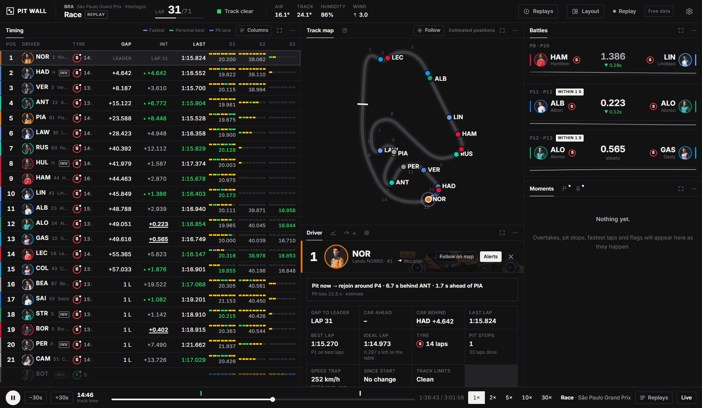
</p>

<p align="center"><sub>Lap 31 of the 2026 São Paulo Grand Prix, replayed from Pit Wall's own recording, following Lando Norris.</sub></p>

<p align="center">
  Free F1 data, no account needed &nbsp;·&nbsp; Delay to match your TV or stream &nbsp;·&nbsp; Laptop and phone &nbsp;·&nbsp; Ready for F1 TV data
</p>

---

## Contents

- [At a glance](#at-a-glance)
- [The timing tower](#the-timing-tower)
- [Follow a driver](#follow-a-driver)
- [Track map and the start](#track-map-and-the-start)
- [Team radio, with live captions](#team-radio-with-live-captions)
- [Flags you can see](#flags-you-can-see)
- [Weather](#weather)
- [Race control and the stewards](#race-control-and-the-stewards)
- [Pace and strategy](#pace-and-strategy)
- [Between sessions: up next and the starting grid](#between-sessions-up-next-and-the-starting-grid)
- [Results](#results)
- [Replays](#replays)
- [On your phone](#on-your-phone)
- [Make it yours](#make-it-yours)
- [With F1 TV (later)](#with-f1-tv-later)
- [Get started](#get-started)
- [Match your TV](#match-your-tv)
- [Configuration](#configuration)
- [How it works](#how-it-works)
- [Good to know](#good-to-know)

## At a glance

| Feature | What you get |
| --- | --- |
| **Timing tower** | Positions, gaps, intervals, sectors, mini-sectors, tyres, pit stops, places gained, driver photos, penalty and stewards badges |
| **Track map** | Every car on the circuit, the grid before the start, follow mode, marshal-sector flags |
| **Driver focus** | One driver in detail: where they would rejoin if they pitted now, penalties owed, investigations, lap chart, their radio |
| **Team radio** | Every clip, with the driver who is talking and a live caption made on your laptop |
| **Flags** | A waving flag and the screen edges lighting up when the track status changes; the five red lights at the start |
| **Weather** | Rain radar with a two-hour forecast, rain chips, and warnings from lap times when rain or a drying track changes things |
| **Stewards** | Investigations followed from "noted" to a decision, time penalties owed and served |
| **Up next** | Countdown, start forecast, and the starting grid after penalties with the reason for each change |
| **Results** | Podium, places gained, fastest lap, penalties applied, decisions still to come |
| **Replays** | Every live session saved; watch it again like a video, with starts, red flags and safety cars marked |
| **Stays up** | Reconnects by itself when the internet drops, and tells you while it does |

## The timing tower

The heart of the screen. Positions, places gained since the start, gap and interval (with an "attack range" mark under a second), last and best laps, the three sectors with their mini-sectors coloured purple, green or yellow, tyre and tyre age, pit stops and the speed trap. Columns hide themselves as the panel narrows, and **Columns** lets you choose.

Badges in the driver column tell you what's going on: **PIT**, **OUT LAP**, **DNF**, a red **+5s** for a time penalty not yet served, and **INV** for a driver under investigation or due to be looked at after the race (hover for what for). In qualifying it shows the knockout zone and the cut-off line.

## Follow a driver

Click a driver anywhere (tower, map, battles, radio, race control) and every panel follows them. Double-click opens the Driver panel; ↑ and ↓ step through the field; Esc stops.

<p align="center">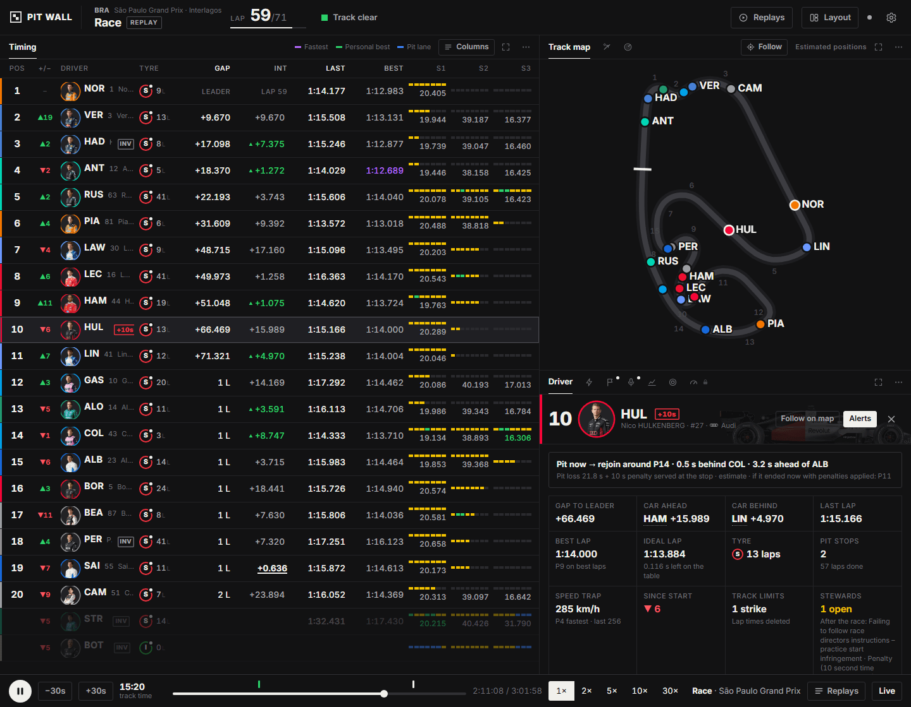</p>

- **Pit now → rejoin around P14**: worked out from the gaps and this circuit's pit-lane loss, including a penalty that would be served at the stop, lapped cars and cars already in the pit lane. When a wave of cars has just stopped (for rain, or for slicks), it also says where they'd come out if the rest follow.
- **If it ended now** with everyone's unserved penalties added.
- **Stewards**: each case with its stage and reason. **Track limits** strikes and the black-and-white flag.
- Gaps to the cars ahead and behind, last, best and ideal lap, tyres and stints, sectors with personal bests, a lap-time chart and the driver's team radio.
- In qualifying: how far inside or outside the cut-off they are.
- Optional pop-ups for their pit stops, overtakes, fastest laps and radio.

## Track map and the start

Every car on the circuit outline, estimated from the timing loops around the lap (or from real GPS with F1 TV). **Follow** zooms in on your driver. Marshal sectors under yellow or red are marked.

<p align="center">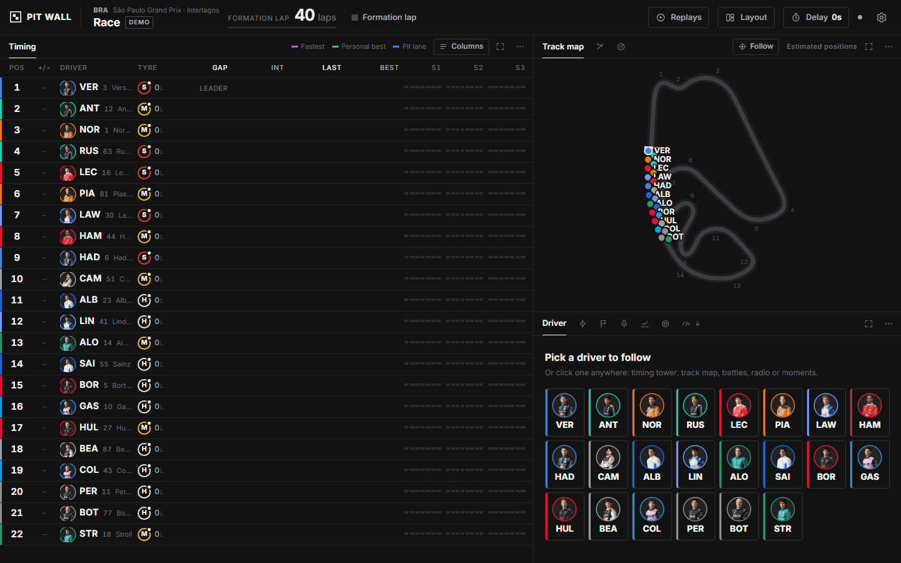</p>

F1's free feed says nothing during the formation lap, so Pit Wall works it out: a countdown to the start, then **Formation lap** with the cars lined up in their grid slots, then lights out and Lap 1. It also understands **Extra formation lap**, **Start delayed**, **Start aborted** and starts behind the safety car.

## Team radio, with live captions

When a clip plays, a card shows who is talking: photo, team, position, level bars that move with their voice, and the words lighting up as they are said. Every clip's text is in the Team radio panel too.

<p align="center">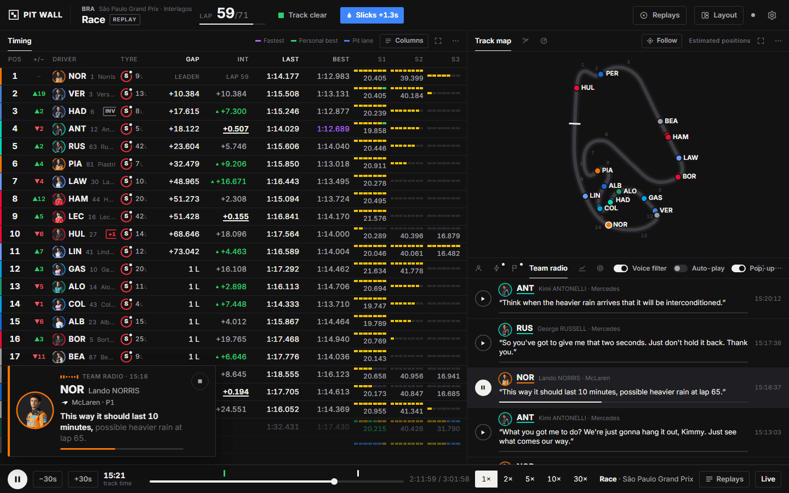</p>

The transcription runs **on your laptop** with OpenAI's Whisper speech model: free, private, and offline after the first download. A clip is ready a few seconds after F1 publishes it, usually before you hear it on TV. Radio is noisy, so it can mishear. A **Voice filter** cuts engine rumble and whine for listening, and **Auto-play** plays new clips as they arrive.

## Flags you can see

When the track status changes, the flag waves on screen and the edges of the screen light up in its colour: green, yellow, safety car, virtual safety car, red and the chequered flag. At the start of a race the five red lights come on and go out.

<table>
  <tr>
    <td>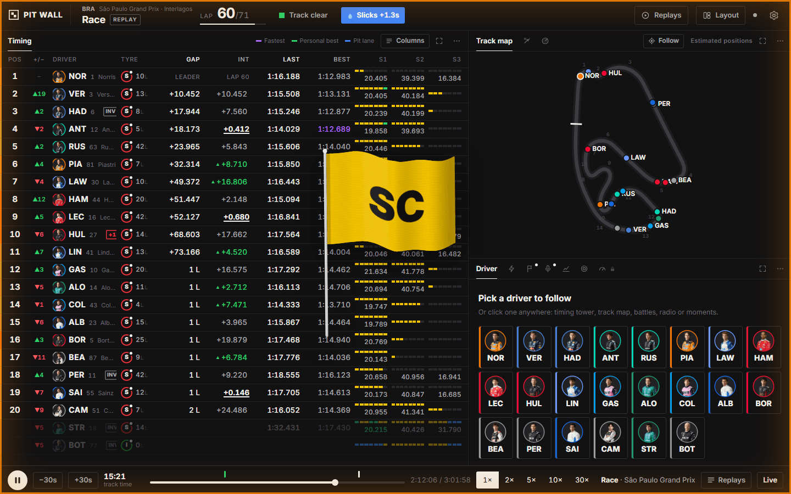</td>
    <td>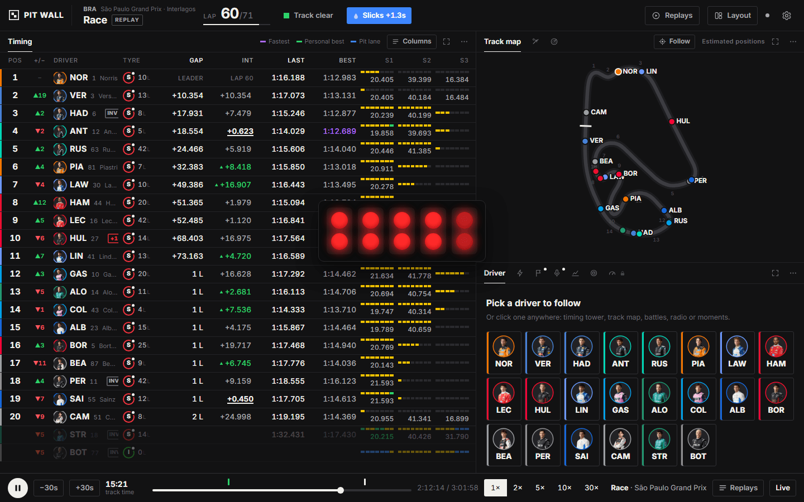</td>
  </tr>
  <tr>
    <td align="center"><sub>Safety car</sub></td>
    <td align="center"><sub>Lights out</sub></td>
  </tr>
</table>

Prefer something quieter? **Layout → Flag changes**: waving flag, screen glow only, or off.

## Weather

<p align="center">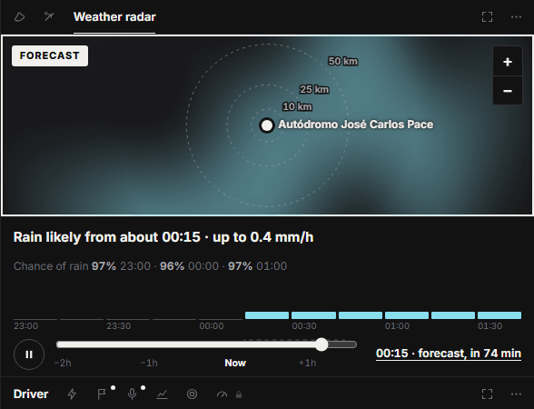</p>

- **Radar**: the last two hours of rain around the circuit (RainViewer) followed by a two-hour forecast (Open-Meteo), with distance rings, wind and an outlook in words: "Rain likely from about 00:15".
- **Rain chip** in the top bar: raining at the track, wet track or low grip declared by race control, how many cars are on intermediates or wets, the announced risk of rain.
- **Lap times as a weather signal**: in the 2026 São Paulo GP the slicks were 1.3 to 1.8 s a lap slower two to four minutes before the field pitted for intermediates. Pit Wall now warns when that happens, when intermediates get quicker on a drying track, and which tyre is faster once cars run both.

## Race control and the stewards

<p align="center">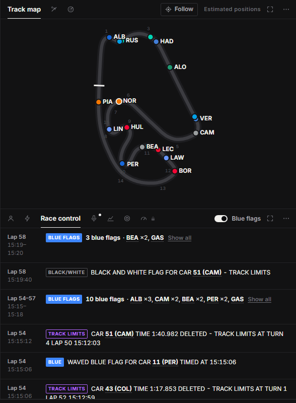</p>

Every race control message with what it is at a glance (flags, penalties, stewards, track limits, weather). Runs of blue flags fold into one line ("6 blue flags · BEA ×2, ALO, CAM…"), or hide them. Restart times are converted to your time too.

The stewards' cases are followed from **noted** to **under investigation** or **after the race**, to a decision, and penalties are tracked until they are served.

## Pace and strategy

<p align="center">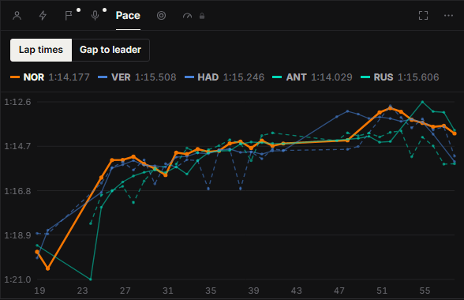</p>

- **Pace**: lap times (and the gap to the leader in races) for your driver and the top five.
- **Battles**: every car within a second and a half of the car ahead, and whether it is closing or dropping back.
- **Moments**: overtakes, fastest laps, pit stops with the time in the pit lane and the new tyres, retirements, flags, penalties and lights out, as they happen.
- **Tyre strategy**: every driver's stints.

## Between sessions: up next and the starting grid

When nothing is running, the timing panel shows what comes next instead of the last session's old timing: a countdown, the forecast for the start, and before a race or sprint the **starting grid after penalties**, in two staggered columns like the real grid, with why each driver moved.

<p align="center">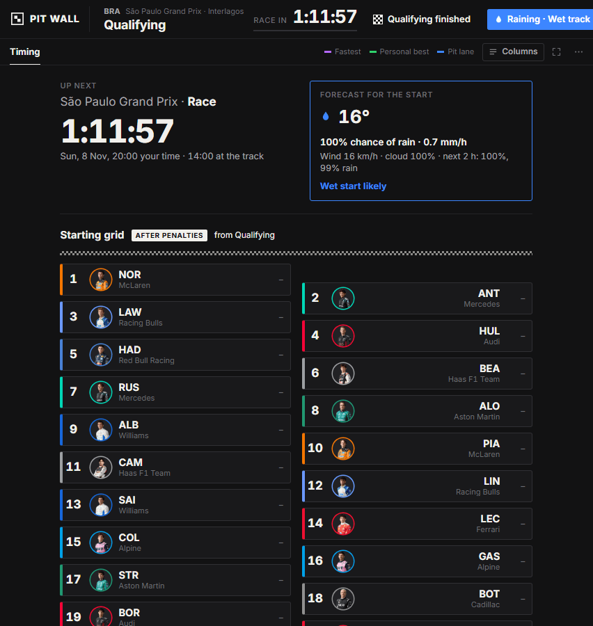</p>
<p align="center"><sub>An hour before the 2026 São Paulo GP: countdown, the forecast for the start, and the grid after penalties.</sub></p>

<p align="center">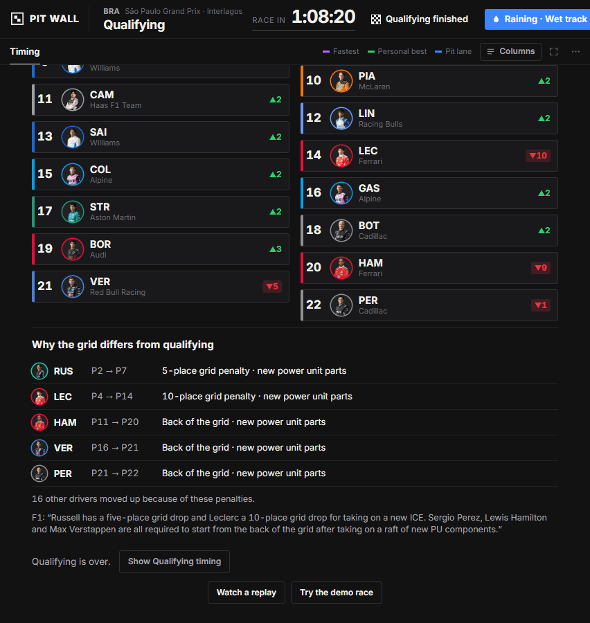</p>
<p align="center"><sub>Why the grid differs from qualifying, with F1's own note.</sub></p>

## Results

<p align="center">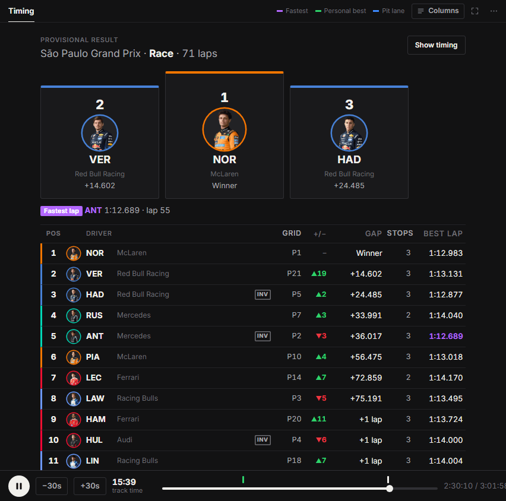</p>

After the chequered flag: the podium, the fastest lap, the full classification with each driver's grid slot and places gained, any unserved time penalties added to the order, and the stewards' cases still open.

## Replays

Every session Pit Wall shows live is saved on the laptop. **Replays** in the top bar lists them with their key moments. A race replay starts a minute before the scheduled start, so you get the formation lap.

<p align="center">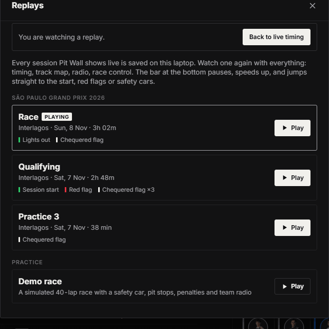</p>

<p align="center">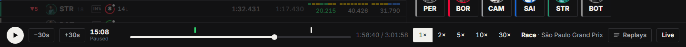</p>
<p align="center"><sub>The player bar: play, pause, 1× to 30×, and the race's start and chequered flag marked on the timeline.</sub></p>

The bar at the bottom works like a video player: play and pause (or the space bar), back or forward 30 seconds, speed from 1× to 30×, and a timeline with starts, red flags, safety cars and chequered flags marked; click one to jump just before it. **Live** goes back to live timing.

## On your phone

The same dashboard, one panel at a time with tabs at the bottom. Open the address Pit Wall prints (or scan the QR code in Settings) on a phone on the same Wi-Fi, and add it to the home screen for a full-screen app. Each screen keeps its own delay and layout.

<table>
  <tr>
    <td>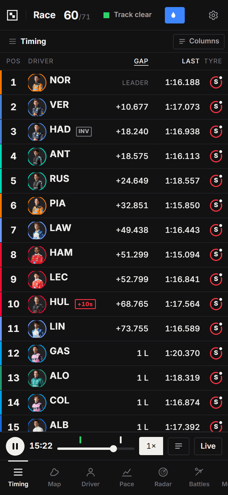</td>
    <td>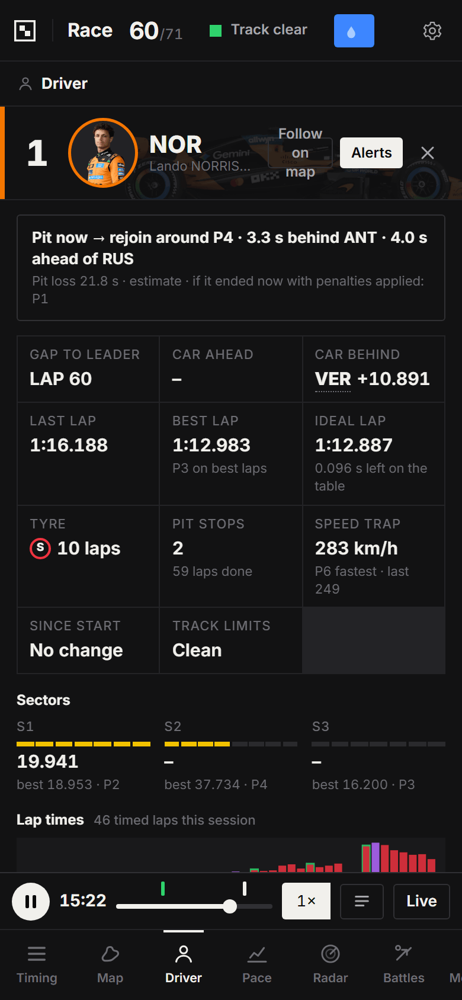</td>
    <td>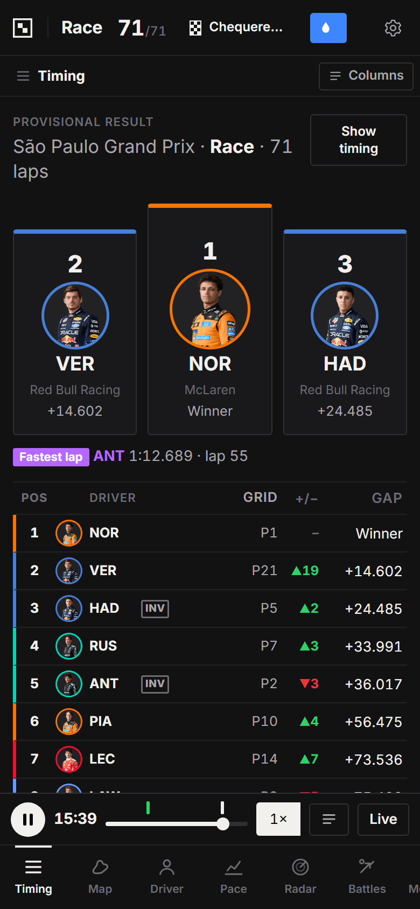</td>
  </tr>
</table>

## Make it yours

<p align="center">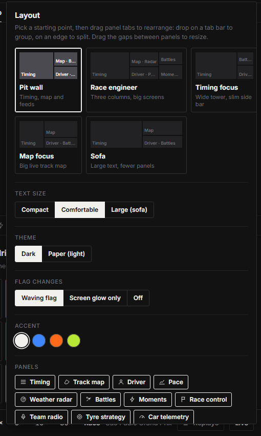</p>

- **Presets**: Pit wall, Race engineer (three columns for big screens), Timing focus, Map focus and Sofa (large text).
- **Drag panel tabs** onto another panel to group them, or onto an edge to split; drag the gaps to resize. Any panel can fill the screen on its own.
- **Text size** (compact, comfortable, large), **dark or paper (light) theme**, accent colour, flag animations.
- Layouts are saved per device.

## With F1 TV (later)

Free data covers everything above. An F1 TV subscription (Access is enough) adds live car telemetry (speed, throttle, brake, gear and RPM for any two drivers, with a speed trace), real GPS positions on the map, and pit-stop times.

<p align="center">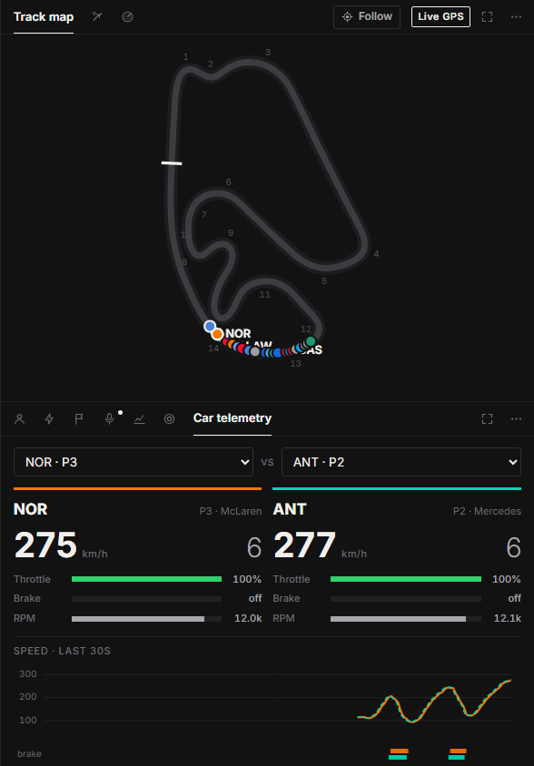</p>

Try it any time with **Settings → Data source → Demo + F1 TV preview**. To connect your own subscription:

1. On the laptop, sign in at formula1.com in Chrome or Edge.
2. Press F12 → Application → Cookies → `https://www.formula1.com`, and copy the value of the `login-session` cookie.
3. In Pit Wall: Settings → F1 TV → paste → Save & connect.

The token lasts about 4 days, so repeat once per race weekend. It is stored only in `config.json` on your laptop (never committed) and only sent to F1. You can also set it with the `F1TV_TOKEN` environment variable.

## Get started

**You need:** Windows, macOS or Linux, [Node.js](https://nodejs.org) 20 or newer, and your own home internet (F1 blocks requests from cloud servers).

```bash
npm install
npm start
```

Open <http://localhost:3000>. On Windows, double-click `start.cmd` instead: it installs what's needed, checks for anything new after an update, and opens the browser.

The terminal also prints an address for your phone (like `http://192.168.1.20:3000`).

| Command | What it does |
| --- | --- |
| `npm start` | Live F1 data. Every session is saved to `recordings/` for replays. |
| `npm run demo` | A simulated 40-lap race at Interlagos, any day of the week: countdown, formation lap, lights out, a VSC, a safety car, pit stops, a penalty and team radio. |
| `npm run demo -- --f1tv` | The demo with the F1 TV-only data. |
| `npm run replay` | The newest recording. Add a file name, `--speed 5`, `--skip 600` (seconds). |
| `npm run record` | Records the live feed without the dashboard. |

You can switch between Live, Replays and Demo from the app without restarting.

## Match your TV

Your TV or stream is behind real time, so the data arrives first. Use **Delay** in the top bar:

- **Presets**: cable or satellite is often 5 to 10 s, streams 30 to 60 s.
- **Quick sync**: pick a car and press "Crossed the line now" the moment you see it cross the line on TV. Pit Wall works out the exact delay.

Each screen has its own delay, so the laptop and the phone can follow different streams. Radio transcripts, flags and alerts all wait for your delay too: nothing is spoiled early.

## Configuration

Copy `config.example.json` to `config.json` to change the defaults:

```json
{ "port": 3000, "defaultDelay": 0, "f1tvToken": "", "transcribe": true }
```

| Setting | What it does |
| --- | --- |
| `port` | Web server port (default 3000). |
| `defaultDelay` | Delay in seconds that new screens start with. |
| `f1tvToken` | F1 TV token (set it from Settings instead). |
| `transcribe` | `false` switches radio transcription off. |
| `transcribeModel` | Whisper model. Default `onnx-community/whisper-small.en`; `onnx-community/whisper-base.en` is faster but less accurate. |

Radio transcription downloads its speech model (about 250 MB) the first time, uses about 1 GB of memory while it works, and frees it after 20 quiet minutes.

## How it works

Pit Wall is a small Node.js server and a web page with no build step. The server connects to F1's live timing feed, keeps a few minutes of history so every screen can watch with its own delay, records each session, and serves the dashboard to the laptop and phones over your Wi-Fi.

If the internet drops, a bar says so and Pit Wall reconnects by itself as soon as it can; a connection attempt that hangs is dropped after 20 seconds and tried again.

| Data | Source |
| --- | --- |
| Timing, flags, race control, team radio, weather station | F1 live timing |
| Car telemetry and GPS (optional) | F1 live timing with an F1 TV token |
| Circuit outlines, pit-lane loss | MultiViewer |
| Driver photos, team logos, cars | F1's image service |
| Starting grid, qualifying result | OpenF1, and formula1.com for the penalty notes |
| Rain radar | RainViewer, on an Esri base map |
| Forecasts | Open-Meteo |
| Season schedule, circuit locations | Jolpica |
| Radio transcripts | Whisper, run locally |

Want to change something? The **[developer guide](docs/DEVELOPER.md)** explains every part of the code and how to change it.

## Good to know

- This uses F1's unofficial live timing feed. F1 changes it without notice (car data moved behind F1 TV in 2025, and F1's archive of past sessions now needs a login), so something may occasionally need fixing.
- For personal use on your own machine. Don't host it publicly.
- Unofficial and not associated with Formula 1. Fonts are under the SIL Open Font License (`public/fonts/LICENSES.txt`).
